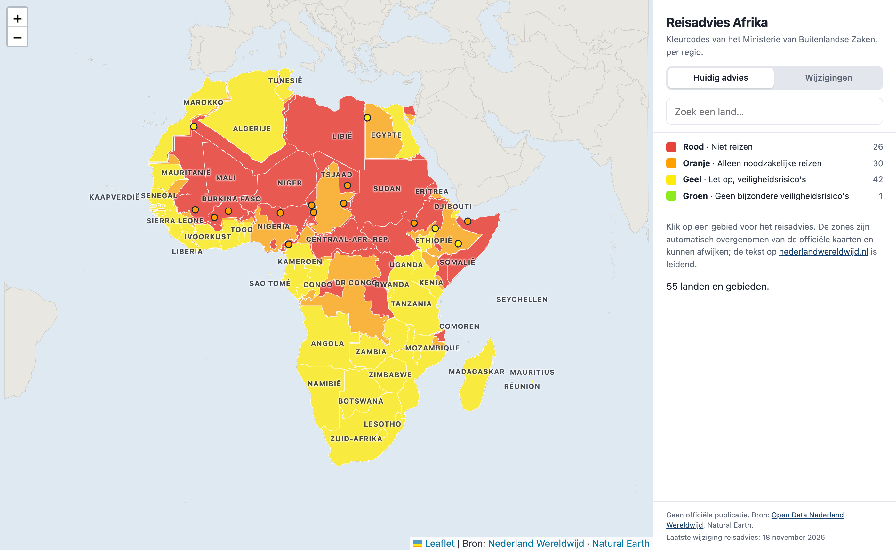
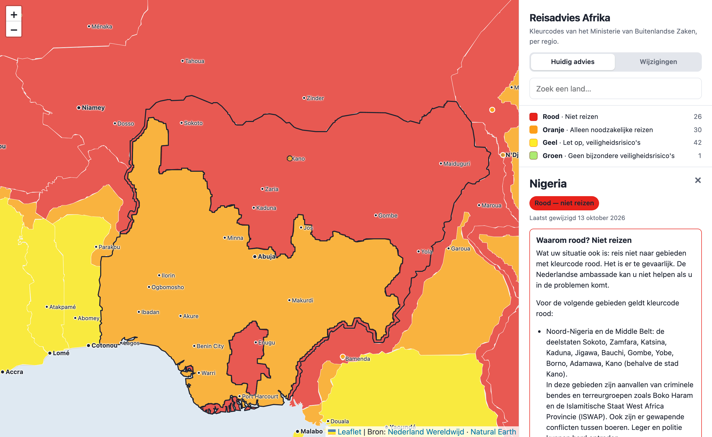
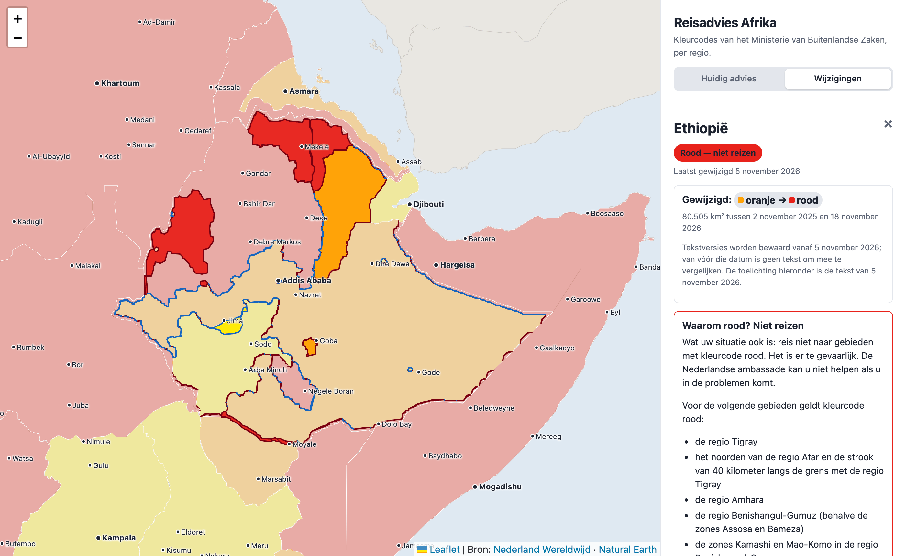
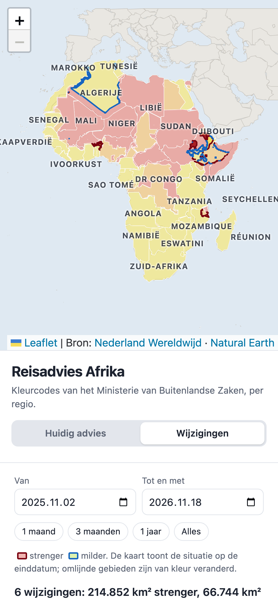

# Reisadvies Afrika — interactive map

An interactive map of the Dutch government's travel advice (*reisadvies*) for every African country,
**per region**, built automatically from the
[Nederland Wereldwijd open-data API](https://opendata.nederlandwereldwijd.nl/).

The ministry publishes one PNG map per country. This project turns those 55 images into a single
vector map (GeoJSON) and a static web app. Click a region to see its colour code, the summary, and the
regional risks text, with a link to the official advice.

> Unofficial. The zones are traced automatically and can be off. The text on
> [nederlandwereldwijd.nl](https://www.nederlandwereldwijd.nl/reisadvies) is always leading.

**Live: [rstoof.github.io/africa-travel-map](https://rstoof.github.io/africa-travel-map/)**



<table>
  <tr>
    <td width="50%"></td>
    <td width="50%"></td>
  </tr>
  <tr>
    <td><b>Click a region</b> for the advice text that explains its colour. Zoom in for city names; dots mark city exceptions such as Kano.</td>
    <td><b>Wijzigingen</b>: compare any two dates. Outlined areas changed colour (dark red stricter, blue milder); click one for the explanation.</td>
  </tr>
</table>

<p align="center"></p>

## How it works

```
fetch.py   API ──► data/raw/<ISO>/advice.json + map.png
trace.py   map.png ──► data/traced/<ISO>.geojson   (+ <ISO>.json fit report)
build.py   traced + advice ──► web/data/{zones.geojson, countries.json, land.geojson}
history.py web/data ──► web/data/history/ (snapshots, diffs, events)
web/       static Leaflet app, no API keys, no tile server
```

**Tracing** (`src/trace.py`), per country:

1. Classify pixels against the fixed map palette (red `#ff0000`, orange `#ffa000`, yellow `#ffff00`, green `#7feb00`).
2. Remove legend swatches and 1–2 px strokes (roads and rivers drawn in red); real zones, including
   "40 km from the border" strips, survive.
3. Detect **city exceptions**: small outlined markers filled with a different colour than their
   surroundings ("Kano state is red, except the city of Kano"). They become 8 km circles named after
   the nearest Natural Earth place.
4. Fit the image onto the Natural Earth outline (scale + offset, Web Mercator or plate carrée, chosen by
   best overlap). Current fits: 91–99.6 % IoU, median ~99 %.
5. Every pixel inside the true outline takes the level of the nearest coloured pixel (fills borders,
   labels and misfit), then the result is vectorized and clipped to the outline.

Single-colour countries skip the fit and use the outline directly.

**Checks** (`src/build.py`): the colours named in each advice summary are compared to the traced
colours. A mismatch (usually a map that lags behind a text update) is printed during the build and shown as a
warning in the app. At the time of writing all 55 countries match.

## The app

- Country names when zoomed out, city names (Natural Earth `min_zoom`) when zoomed in, with simple
  collision avoidance. City exceptions (e.g. Kano, Bamako) get a fixed-size dot so they stay visible.
- Clicking a zone opens the country panel with **"Waarom deze kleur?"**: the part of *Regionale risico's*
  for that colour, then a link to the full advice on nederlandwereldwijd.nl.

## Change history

`src/history.py record` compares the freshly built zones with the last snapshot of each country.
Only when the colours change (≥ 50 km², or a different set of levels) does it store a new snapshot
`web/data/history/<ISO>/<date>.geojson`. For every pair of snapshots it precomputes the areas whose level
differs (`diff_<a>_<b>.geojson`, with from/to level and km² in an equal-area projection).

A change is dated by the date in the ministry's map file name (`Reisadvies_Mali_12-11-2026.png`)
when that's plausible; otherwise it's recorded as "between the previous snapshot and today".
Text-only updates (new `lastmodified` without colour change) are logged separately.

Each version of the advice text is stored too (`text_<date>.json`, from the first run on), so clicking
a changed area shows the text section for its new colour and, once older versions exist, a
sentence-level diff of what changed in the text.

In the app, the **Wijzigingen** tab lets you pick any period: the map shows the situation on the end
date, outlines the areas that changed colour (dark red = stricter, blue = milder), and lists the changes.
Each country's detail panel shows its own history. Deep link: `#wijzigingen/2025-11-02/2026-11-18`.

The history starts on **2 November 2025**, backfilled from maps saved by an earlier project:

```bash
python src/history.py backfill <dir with <locationkey>_legend.png> 2025-11-02
```

## Monitoring

The daily workflow commits new snapshots and **opens a GitHub issue** listing the colour changes.
Watch the repository to get these by e-mail.

## Run it

```bash
python3 -m venv .venv && .venv/bin/pip install -r requirements.txt
make all        # ref data, fetch, trace, build, history  (~1–2 min)
make serve      # http://localhost:8000
```

Open `http://localhost:8000/#NGA` to deep-link a country (ISO3 code).

## Automation

`.github/workflows/update.yml` runs daily: fetch → trace → build → history, commits changed data,
opens an issue for colour changes, and deploys `web/` to GitHub Pages. Enable Pages with source **GitHub Actions** in the repository settings.

## Known limitations

- Exceptions that the map doesn't draw (e.g. specific neighbourhoods of Nairobi or Mombasa) are only in the text.
- Lakes are part of the country outline in Natural Earth and get coloured.
- Territories without their own advice (Western Sahara, Mayotte, St Helena) are not shown separately;
  Western Sahara is covered by the Morocco advice map.

## Sources

- Travel advice and maps: Ministerie van Buitenlandse Zaken, via the Nederland Wereldwijd open-data API.
- Boundaries and places: [Natural Earth](https://www.naturalearthdata.com/) (public domain).
